# Azure Directory Project: Active Directory, Group Policy and osTicket

I built a small business IT environment in Azure for a fictional company, SmallCo Manufacturing. It has a domain controller, a domain-joined Windows client and a ticket server. After the build I broke an account on purpose and worked it as a help desk ticket, from the user's report to the fix.

This write-up covers what I built, how I built it, the one ticket I worked end to end, and what I did not verify.

| VM | OS | Size | Private IP | Role |
|---|---|---|---|---|
| SC-DC01 | Windows Server 2022 | Standard_B2s | 10.0.1.4 | AD DS, DNS, file shares |
| SC-CLIENT01 | Windows (domain-joined) | Standard_B2s | 10.0.1.5 | User workstation |
| SC-TKT01 | Ubuntu 22.04 | Standard_B1ms | 10.0.1.6 | osTicket in Docker |

Domain: `smallco.local` (NetBIOS `SMALLCO`).

The step-by-step build guide is in [`AZURE-LAB-GUIDE.md`](AZURE-LAB-GUIDE.md).

---

## 1. Network and access control

I created one resource group, one virtual network (10.0.0.0/16, subnet 10.0.1.0/24) and a network security group on the subnet. The NSG allows only three inbound rules, each limited to my own public IP: RDP (3389), SSH (22) and the osTicket web port (8080). Everything else inbound is denied by default.

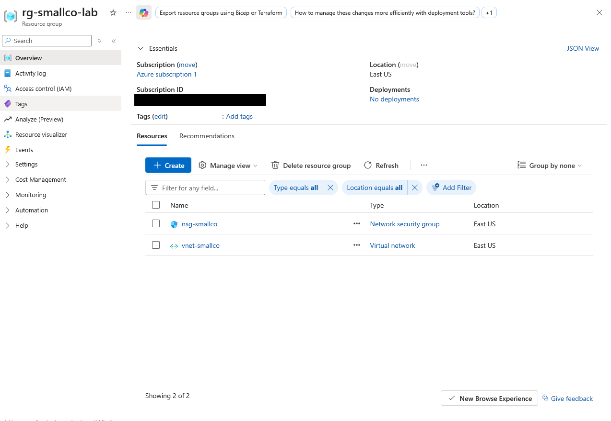

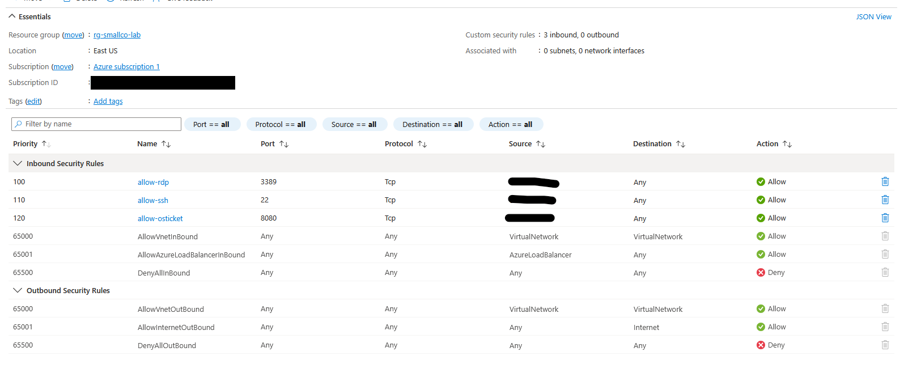

Source addresses and the subscription ID are blacked out in these screenshots.

All three VMs were created with static private IPs and run on the same subnet.

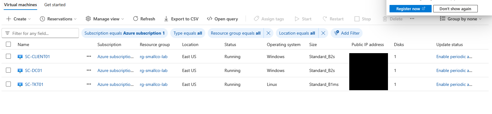

---

## 2. Active Directory

I promoted SC-DC01 to a domain controller for a new forest, `smallco.local`, with DNS installed on the same server. I then pointed the virtual network's DNS setting at the DC (10.0.1.4) so the client and ticket server could find the domain.

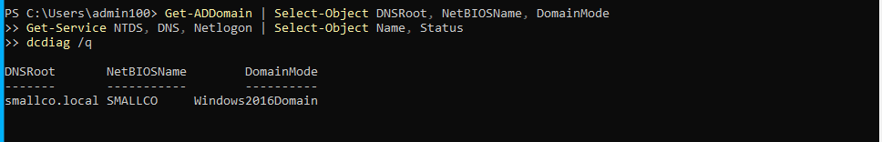

Structure:
- A top-level `SmallCo` OU with child OUs for Sales, Finance, Engineering, Operations and Leadership.
- Separate `Workstations` and `Servers` OUs so computer policies can target machines on their own.
- A global security group per department (`GRP-Sales`, `GRP-Finance`, and so on).
- 10 users imported from a CSV with PowerShell and placed in their department OU and group.

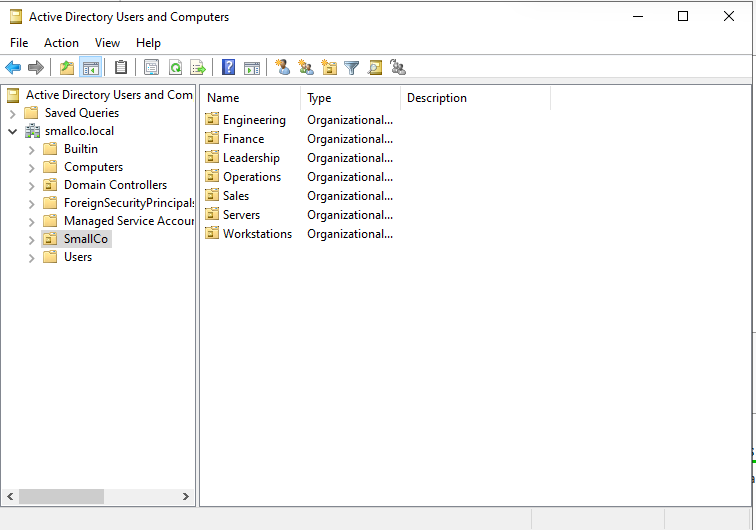

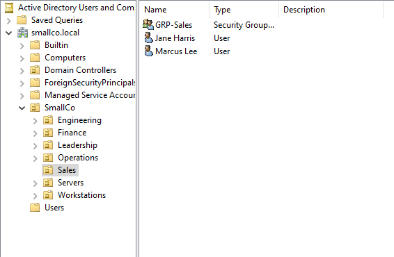

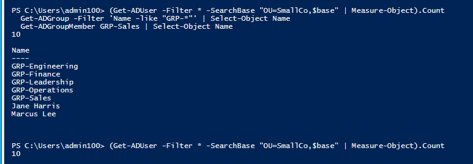

I also created two SMB shares on the DC: `Company` (full access for Domain Users) for a mapped drive, and `Wallpaper` (read access) for the desktop background image.

---

## 3. Group Policy

I built one policy for each common office requirement and linked each to the OU where it belongs.

| GPO | Type | Linked to | Purpose |
|---|---|---|---|
| Default Domain Policy | Password and lockout | Domain | Minimum 12 characters, complexity on, 90-day maximum age, 10-password history, lockout after 5 bad attempts for 30 minutes |
| USR - Corporate Wallpaper | User | SmallCo OU | Sets the desktop background from `\\SC-DC01\Wallpaper\smallco.jpg` |
| CMP - Block USB Storage | Computer | Workstations OU | Denies all removable storage |
| USR - Restrict Control Panel (Sales) | User | Sales OU | Hides Control Panel for the Sales team |
| USR - Map Company Drive | User | SmallCo OU | Maps `S:` to `\\SC-DC01\Company` |

Password and lockout policy:

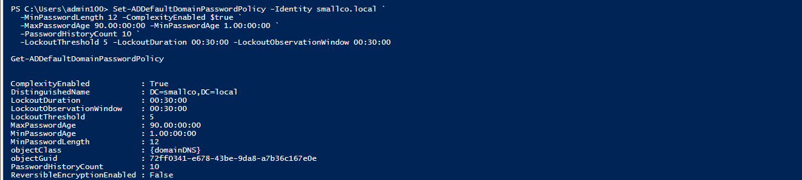

Wallpaper policy, created in PowerShell and then checked in the Group Policy editor:

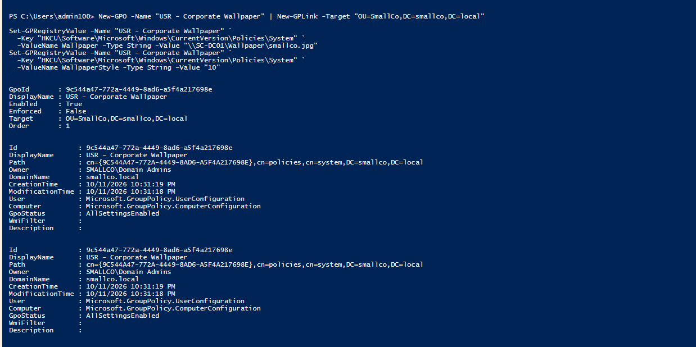

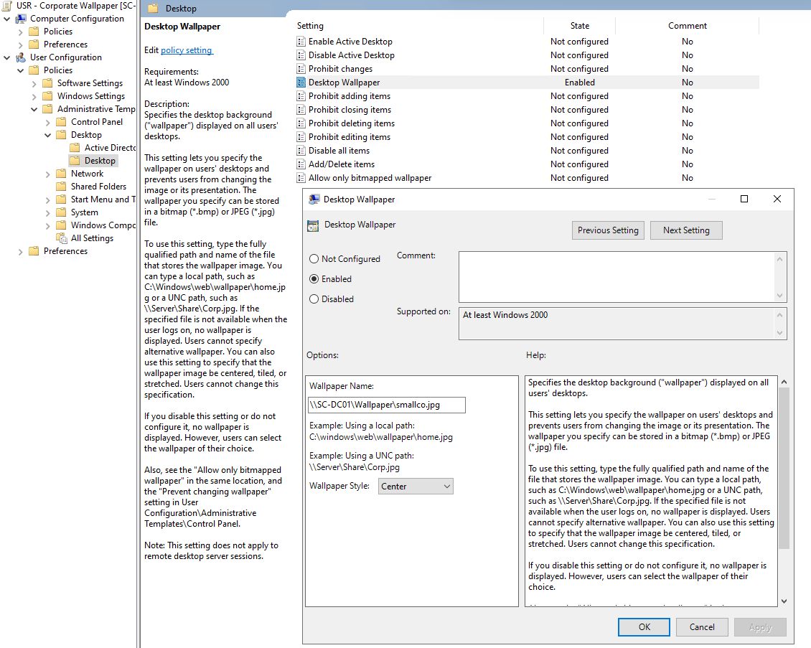

USB storage block, linked to the Workstations OU:

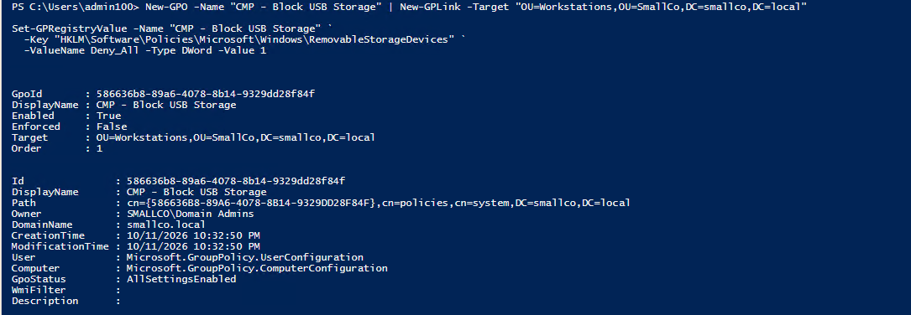

Group Policy Management with all GPOs, plus the drive map preference:

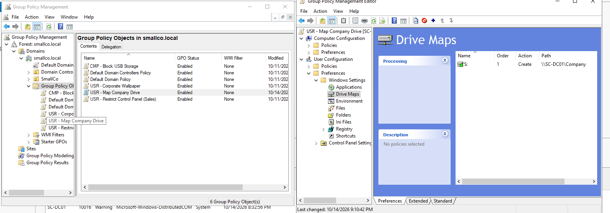

Choices I made on purpose:
- Computer policies (USB) target the Workstations OU, and user policies (wallpaper, Control Panel, drive map) target user OUs. A GPO only applies where its settings match the object type it is linked to.
- The Control Panel restriction is linked at the Sales OU, not the domain, to show scoped policy.

---

## 4. Domain join

I joined SC-CLIENT01 to `smallco.local` from a local administrator session and then moved its computer object into `OU=Workstations,OU=SmallCo` so the computer policies apply. One mistake worth recording: my first two attempts ran the join command on the DC by mistake, which failed with "Cannot add computer 'SC-DC01' to domain 'smallco.local' because it is already in that domain." The error and the `SystemName` in the output showed I was on the wrong machine. Checking `hostname` before running anything is now my habit.

I confirmed from the Azure side that the client reports `PartOfDomain: True` for `smallco.local` and that its computer object sits in the Workstations OU.

---

## 5. Ticketing with osTicket

SC-TKT01 runs osTicket and MariaDB in Docker Compose. The compose file and its setup notes are in this repo. I generated the database secrets on the VM at deploy time, so none are stored in the repo.

The image I used installs its own database and removes the `/setup` directory on first start, so there was no installer wizard to run. The staff dashboard loaded on port 8080.

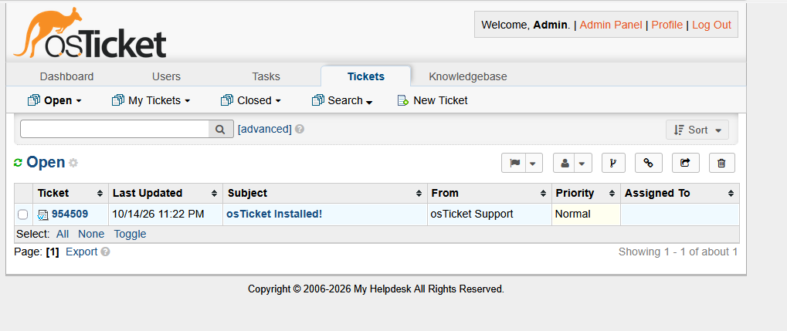

---

## 6. Ticket T002: Account lockout

Full write-up: [`tickets-seed/T002-account-lockout.md`](../tickets-seed/T002-account-lockout.md).

Scenario: A Sales rep, Marcus Lee, submits osTicket #361171: "I'm locked out. plz help". There is no error text and no detail, so the first job is to find out what is actually wrong.

I caused the lockout by generating five bad password attempts for `marcus.lee` against the domain, which hit the threshold of 5 set in the domain policy.

Diagnosis, on the DC:

```powershell
Get-ADUser marcus.lee -Properties LockedOut,BadLogonCount,LastBadPasswordAttempt
Get-WinEvent -FilterHashtable @{LogName='Security';Id=4740} -MaxEvents 1
```

The account output shows `LockedOut : True` and `BadLogonCount : 5`. The Security log has event 4740 ("A user account was locked out") with the caller computer name. The account is enabled, so this is a lockout, not a disabled account.

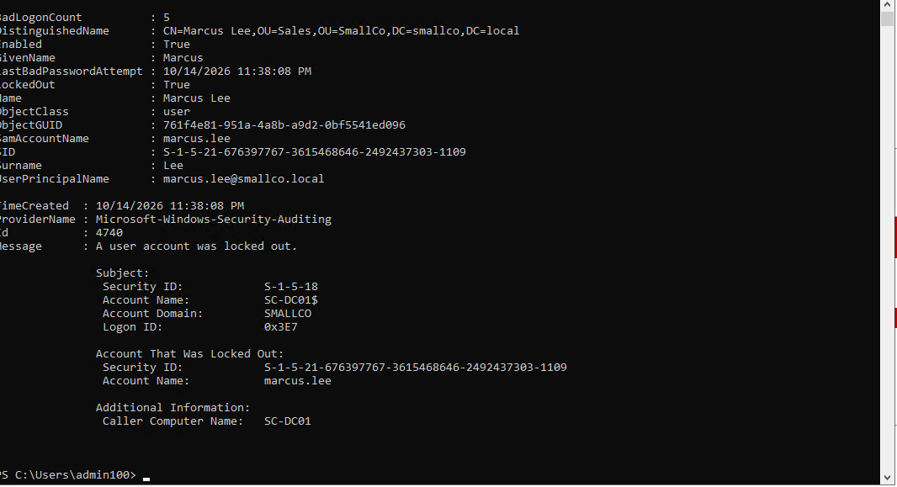

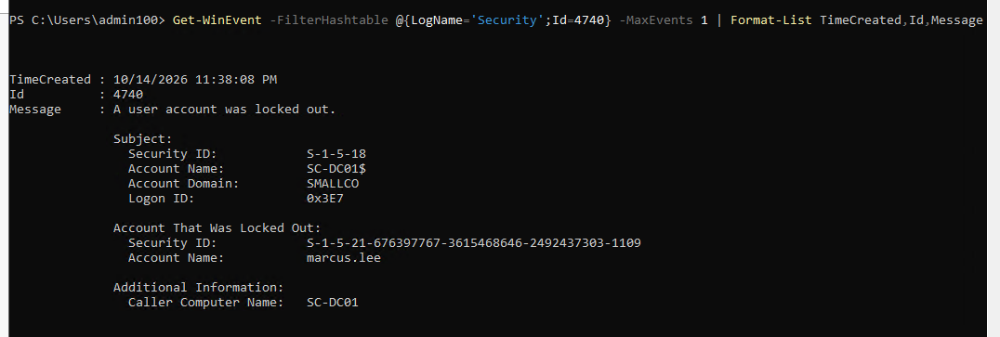

Resolution: after confirming the caller's identity, I unlocked the account and verified it.

```powershell
Unlock-ADAccount marcus.lee
Get-ADUser marcus.lee -Properties LockedOut | Select SamAccountName,LockedOut
```

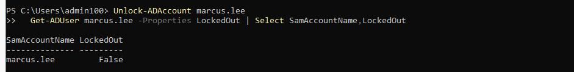

The ticket as the user filed it, and the same ticket after I claimed it, added an internal note and replied:

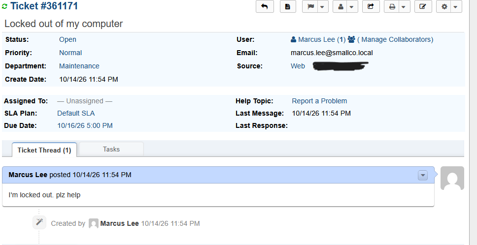

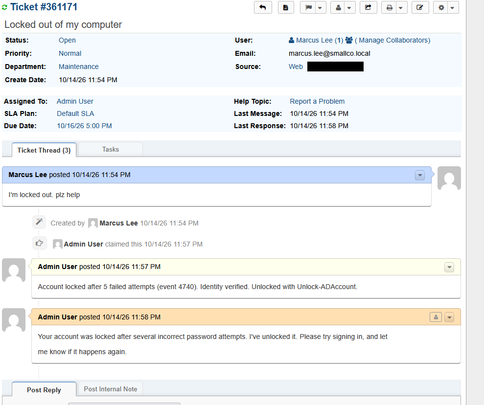

Lab note: because the bad attempts were generated from the DC, the lockout event shows `SC-DC01` as the caller. On a real ticket, that field names the machine sending the bad password, which is where I would look for a phone, mapped drive or service holding an old credential.

---

## 7. What I did not verify

I want this write-up to be accurate, so these are the gaps:
- I did not capture client-side Group Policy results (`gpresult`) for a signed-in Sales user. The GPOs are created and linked, but the screenshots above do not show the wallpaper, `S:` drive, Control Panel block or USB block taking effect on the client.
- When I first looked for the `S:` drive, it was missing. A check of the DC showed the drive-map GPO existed but was not linked to an OU and had no drive entry. I built the entry afterward (last screenshot in section 3) but did not re-test on the client before tearing down the lab.
- Only 10 users were created, not a full 25-person company.
- Only one ticket (T002) was worked end to end in this session. The other scenarios in the guide were not run.

---

## 8. Cleanup

To avoid ongoing cost I deleted the resource group once I had captured screenshots and written the ticket. The commands in the guide rebuild the environment, and the scripts and compose file in this repo are enough to bring it back.

## Skills shown

Active Directory and DNS, OU and group design, Group Policy (password, user, computer and preference policies), domain join and OU placement, account lockout diagnosis with PowerShell and the Security event log, ticketing in osTicket, Docker Compose deployment, Azure networking with a locked-down NSG, and writing up a ticket as Problem, Diagnosis and Resolution.
